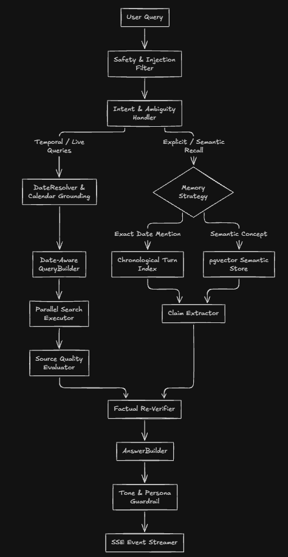
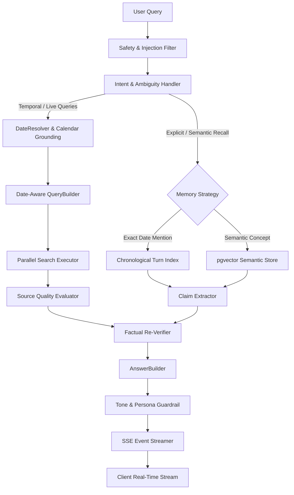

# Mimi: System Design

Built for the Minimi assignment. An AI chat agent with web search, calendar intelligence, factual re-verification, and semantic vector memory.

When building a chat agent with web search and memory, the real challenge is balancing speed with factual accuracy. Most agents either hallucinate past details, get bogged down in multi-minute thinking loops, or sound like a robotic database admin reciting query logs.

I designed Mimi around a single principle: **keep the pipeline deterministic, the memory unified, and the conversation natural.**

---

## 1. How the Pipeline Works

Rather than letting an autonomous agent wander through unbounded tool loops, Mimi routes every user turn through a coordinated, predictable pipeline:

### Calendar Grounding & Temporal Anchoring
LLMs struggle with temporal reasoning. When a user says *"Monday"* or *"last Tuesday"*, the model tends to guess or rely on stale training data. I resolve every relative date deterministically against the current calendar date at UTC midnight. If a search query contains an outdated year like 2022, I modernize it to 2026 and attach a temporal filter (`since November 2026`) so search engines return fresh updates.

### Targeted Parallel Search
Broad search queries often miss changes across multiple products. When a prompt mentions several tools, I fan out targeted queries in parallel. Results are deduplicated and scored by domain authority: primary vendor documentation (such as `hubspot.com` or `neon.tech`) receives higher weight than aggregators and community forums.

### Dual-Layer Memory
Human conversation requires two kinds of memory:
1. **Chronological lookup**: Locating a specific exchange by calendar date (*"What did I ask on 3 November?"*). This runs as a direct indexed database query on `(conversationId, timestamp)`.
2. **Concept recall**: Remembering preferences or past topics when words do not overlap (*"cold weather vacation"* connecting to *"Hokkaido skiing"*). This runs through PostgreSQL using `pgvector` with 768-dimensional embeddings generated by Gemini.

### Factual Claim Re-Verification
When a user asks if a past answer is still true, the agent doesn't guess. It extracts verifiable metrics (prices, seat counts, storage limits) from the previous assistant response, searches current sources, and determines whether each fact is still correct, outdated, or unconfirmed. The response leads with a clear summary headline followed by a comparison table.

### Natural Conversational Tone
Many memory-enabled assistants announce their internal mechanics (*"Noted for future reference"*, *"Connecting back to our previous chat"*). I put strict guardrails in the system prompt to eliminate this meta-talk: recalled facts must be woven naturally into the answer, just like human recall.

---

## 2. Why I Built It This Way

- **One Coordinated Pipeline Over Agent Swarms**: Autonomous multi-agent setups (agents debating with other agents) sound impressive on paper, but in practice they produce 20-second latencies, unpredictable token bills, and fragile error loops. A deterministic pipeline gives sub-second tool execution, consistent answer structures, and testability.
- **Postgres as the Single Source of Truth**: Instead of managing a separate vector database alongside a relational store, I keep conversation threads, messages, and vector embeddings together in PostgreSQL using `pgvector`. This eliminates distributed state synchronization, avoids dual-write failures, and keeps local setup to a single Docker container.
- **Answer-First Formatting**: Users asking about pricing or tool changes want the verdict immediately, not three paragraphs of preamble. The agent leads with the bottom line, presents structured comparison tables, and attaches inline citations to primary sources.

---

## 3. What I Considered and Rejected

- **Heavy Agent Frameworks (LangChain, CrewAI, AutoGen)**: I started by evaluating standard agent libraries, but rejected them due to excessive abstraction layers, bloated system prompts, and slow turnarounds. Building lightweight, typed services in native TypeScript gave full visibility and instant boot times.
- **Headless Browser Scraping (Playwright, Puppeteer)**: Navigating live browser DOMs takes 10 to 30 seconds per page and routinely gets stuck behind Cloudflare challenges. Tavily delivers clean, pre-parsed markdown snippets in roughly 400 milliseconds.
- **Pure Full-Text Search (tsvector)**: Standard keyword search completely breaks when a user asks about *"thermal baths"* after previously discussing *"onsen"*. Dense vector embeddings provide the vocabulary invariance needed for real human conversations.
- **Multi-Pass LLM Self-Critique**: Having the model review its own output in a second turn doubled latency with negligible improvement in quality. I achieved better results by giving clear formatting directives upfront (headline-first, markdown tables, direct citation links).
